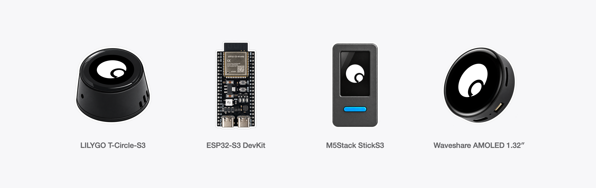

# Comma Hardware

Firmware that turns a small ESP32 board into a home gateway for the [Comma](https://comma.surf) app.
The board stays plugged in at home, connects out to the Comma backend, and lets your Comma agent
reach devices on your home network (lights, air conditioners, cameras, local web APIs) even when
your phone or computer is away. On boards with a microphone and a speaker, it is also a voice
terminal: press once to talk to Comma, press again to hang up.

The board knows no device protocols. It forwards HTTP requests, UDP datagrams and TCP streams that
the backend asks for, only to addresses on its own network, and only after you allow device
operations in the app. New appliances need no firmware change.

## Boards

| Board | Chip, flash / PSRAM | Gateway | Voice | Screen | Pairing | Build |
| --- | --- | --- | --- | --- | --- | --- |
| [LilyGO T-Circle-S3](https://lilygo.cc/products/t-circle-s3) | ESP32-S3, 16 MB / 8 MB | HTTP, UDP, discovery, 2 TCP tunnels | Yes (tap the screen) | 160 px round | Passkey on screen | `tools/board.sh t-circle-s3 build` |
| [M5Stack StickS3](https://shop.m5stack.com/products/m5stack-sticks3-esp32s3-mini-iot-dev-kit) | ESP32-S3-PICO-1, 8 MB / 8 MB | HTTP, UDP, discovery, 2 TCP tunnels | Yes (front key) | 135x240 | Passkey on screen | `tools/board.sh m5stack-sticks3 build` |
| [Waveshare ESP32-S3-Touch-AMOLED-1.32](https://www.waveshare.com/esp32-s3-touch-amoled-1.32.htm) | ESP32-S3-PICO-1, 8 MB / 8 MB | HTTP, UDP, discovery, 2 TCP tunnels | No (no speaker on the board) | 466 px round AMOLED | Passkey on screen | `tools/board.sh waveshare-amoled-1-32 build` |
| [ESP32 DevKit](https://www.espressif.com/en/products/devkits/esp32-devkitc) (classic ESP32, e.g. ESP32-DevKitC) | ESP32-D0WD, 4 MB / none | HTTP (8 KiB text, 4 KiB chunks), UDP, discovery (12 KiB result); no TCP tunnels | No | No (status LED on GPIO2) | Just Works, no MITM protection | `tools/board.sh esp32-devkit build` |

The DevKit build targets the classic ESP32 with 4 MB flash and no PSRAM. ESP32-S3 development
boards are not supported by that build. Board details, limits and test status are in
[devices/README.md](devices/README.md). See the [validation notes](docs/validation.md) for the
current test coverage and remaining checks.

## Quick start

### 1. Install ESP-IDF 6.0.2

Install **ESP-IDF v6.0.2** with the ESP32 and ESP32-S3 tools, following Espressif's
[installation guide](https://docs.espressif.com/projects/esp-idf/en/v6.0.2/esp32s3/get-started/index.html)
(macOS, Linux and Windows). Activate it in your terminal, then check:

```sh
idf.py --version   # ESP-IDF v6.0.2
```

Use this exact version. The build patches a NimBLE pairing timeout at configure time and relies on
this version's lwIP internals. A newer IDF needs its own validation.

### 2. Build

From the repository root:

```sh
tools/board.sh t-circle-s3 build
```

Replace `t-circle-s3` with your board from the table. No Wi-Fi password, account or credential is
needed to build. The first build downloads the locked managed components, so it needs internet
access. Build one board at a time: all boards share `firmware/managed_components/`. Output goes to
`firmware/build-<board>/`.

### 3. Flash

Connect the board with a USB data cable and find its serial port (`/dev/cu.usbmodem*` or
`/dev/cu.usbserial-*` on macOS, `/dev/ttyACM*` or `/dev/ttyUSB*` on Linux, `COMx` on Windows):

```sh
tools/board.sh t-circle-s3 flash-monitor PORT
```

The first flash must write everything (bootloader, partition table, app and, on voice boards, the
speech model partition): use `flash`, not `app-flash`. Exit the monitor with Ctrl+]. Flashing does
not erase saved settings; erase flash only if you want the board to forget its setup.

Download mode, per board:

- **T-Circle-S3 and Waveshare AMOLED** (native USB): esptool enters download mode by itself. If it
  cannot connect, hold BOOT while plugging in USB, then flash. If the Waveshare stays silent with a
  blank screen after flashing on macOS, unplug and replug USB without touching BOOT.
- **StickS3** (native USB): download mode is automatic, no key needed. Opening the serial port resets
  the board. A long press on the separate power button also enters download mode.
- **ESP32 DevKit** (USB-UART bridge, often a CH340 or CP210x): install the bridge's driver if no port
  appears. If esptool stays at `Connecting...`, hold BOOT until it starts writing.

### 4. Set up from the app

A new board advertises over Bluetooth as `Comma-XXXX` (the last four hex digits of its MAC). In the
Comma Android app, add a device, enter the code shown on the board's screen (screen boards), choose a
**2.4 GHz** Wi-Fi network, and wait for the board to come online. The app issues the board its own
Connector token and voice key, which it keeps in flash. Then allow device operations for it in the
app's device settings: a new board starts read-only and refuses every network request.

The setup protocol is documented in [docs/ble-provisioning.md](docs/ble-provisioning.md), and the
gateway protocol in [docs/connector-protocol.md](docs/connector-protocol.md). Runtime calls and LAN
control need the Comma backend; this repository has the firmware and development tools only.

### 5. Keys

| | T-Circle-S3 | StickS3 | Waveshare AMOLED | ESP32 DevKit |
| --- | --- | --- | --- | --- |
| Call / hang up | Tap the screen | KEY1 (front) | — | — |
| Wake the screen | Tap (a tap also calls) | Short KEY2 press | Tap or short BOOT press | — |
| Pairing mode: hold 3–10 s, then release | BOOT | KEY2 (side) | BOOT | BOOT |
| Factory reset: hold more than 10 s | BOOT | KEY2 | BOOT | BOOT |

Pairing mode lets the app reconfigure a board that is already set up (new Wi-Fi, new credentials);
it ends after 5 minutes without a connection. Factory reset erases Wi-Fi, credentials and Bluetooth
keys, and the board restarts unconfigured. A key still held when the board starts is ignored until
released. The DevKit's LED is off normally, blinks slowly while advertising, quickly while the app is
connected, and stays on for about 3 s after setup is saved.

On voice boards, tapping while Wi-Fi is unavailable waits up to 20 seconds for it to return.
Tap again to cancel. Pairing/reset holds remain responsive and cancel the pending call.

## Security notes

- **Pairing.** Every board uses LE Secure Connections only (legacy pairing is refused) and requires an
  encrypted link before any setup characteristic can be read or written. Screen boards show a random
  six-digit passkey (MITM protection). The ESP32 DevKit has no display or keypad, so it pairs with
  **Just Works**: the link is encrypted, but an attacker within Bluetooth range during setup can
  intercept it. Physical access (holding BOOT) is required to reopen setup on a configured board, but
  that is not cryptographic protection. Set up a DevKit where nobody else is in radio range.
- **Bluetooth is off** on a configured board except in pairing mode, and never on during a call.
- **Stored credentials are not encrypted.** These builds do not enable Secure Boot, flash encryption
  or NVS encryption, so anyone holding the board can read its Wi-Fi password, Connector token and
  voice key over USB. Both credentials are per device and are revoked when you remove the device in
  the app; factory reset erases them.
- **The gateway is read-only until you allow it.** The board itself enforces this: while device
  operations are off, it refuses every LAN request without touching the network. Requests may only
  go to addresses on the board's own subnet and private ranges, never to the board itself, loopback,
  broadcast or multicast addresses.
- Changing the workspace, group, backend URLs, Connector token or voice key resets operation
  permission; allow operations again in the app. Changing only Wi-Fi or the device name preserves
  permission. With compiled-in development credentials, permission lasts only until reboot.
- The Bluetooth advertising data uses the test company ID `0xFFFF`.
- There is no OTA update; update by USB.

## Development

### Host tests

Python tools and tests use their own virtual environment, separate from ESP-IDF:

```sh
python3 -m venv tools/.venv
. tools/.venv/bin/activate
python -m pip install -r tools/requirements.txt
python -m unittest discover -s firmware/tools -p 'test_*.py'
```

The C host tests compile the real LAN, JSON and audio code against small ESP-IDF stubs with
AddressSanitizer and UndefinedBehaviorSanitizer. They currently target **macOS** (the HTTP test uses
CommonCrypto). Build one board first (for the managed cJSON component), activate ESP-IDF, then:

```sh
sh firmware/tools/lan_discover_test/run.sh
sh firmware/tools/lan_http_test/run.sh
sh firmware/tools/lan_udp_test/run.sh
sh firmware/tools/lan_tunnel_test/run.sh
sh firmware/tools/connector_json_test/run.sh
sh firmware/tools/resample_test/run.sh
sh firmware/tools/mic_path_test/run.sh
sh firmware/tools/device_config_test/run.sh
sh firmware/tools/call_ui_test/run.sh
# The DevKit's smaller limits:
sh firmware/tools/lan_http_test/run.sh --devkit
sh firmware/tools/lan_udp_test/run.sh --devkit
sh firmware/tools/lan_discover_test/run.sh --devkit
```

They do not replace board tests for Wi-Fi, Bluetooth or audio.

### Tools

- `firmware/tools/ble_provision.py`: set up a board over Bluetooth from a computer, as the app does
  (`scan`, `info`, `wifi-scan`, `provision`). Its `--server` and `--connect-url` default to the
  production backend; pass both to use another one. Secrets come from environment variables.
- `firmware/tools/fake_connector.py`: a local Connector server for testing a board without the
  backend. Build with `-DCOMMA_CONNECT_URL_OVERRIDE=ws://<your-computer>:8765/v1/connect` in a
  separate build directory (see [devices/README.md](devices/README.md)).
- `firmware/tools/connector_regression.py --report /tmp/connector-regression.json`: live-board
  HTTP/UDP regression checks using that same override image. Tests interim responses, FIN versus
  reset, queued deadlines, permission revocation and disconnect cancellation. It temporarily changes
  operation permission and restores the original value after completion; wait for `DONE`, then
  restore the normal firmware. On interruption, check the permission in the app before resuming use.
- `tools/lan_mcp_server.py`: a tiny MCP server to stand in for a device on your network.
- For a development board, `firmware/main/secrets.h.example` shows how to compile credentials in
  instead of using Bluetooth setup. `secrets.h` is ignored by Git; never ship such an image.

### Layout

| Path | Contents |
| --- | --- |
| `firmware/main/` | Shared gateway: Connector, LAN methods, Wi-Fi, Bluetooth setup, keys, Kconfig |
| `firmware/voice/` | Shared voice call: voice session, playback, noise suppression and VAD |
| `firmware/ui/` | Shared screen cards, fonts and logo for each screen size |
| `firmware/boards/<board>/` | Pins and drivers for one board |
| `firmware/components/` | Vendored GC9D01 LCD driver (Espressif, Apache-2.0) |
| `devices/` | Per-board configuration overlays and board notes |
| `tools/board.sh` | Build, flash and monitor one board with its own config and build directory |

### Adding a board

1. Read [docs/connector-protocol.md](docs/connector-protocol.md),
   [docs/ble-provisioning.md](docs/ble-provisioning.md) and [devices/README.md](devices/README.md).
2. Put pins and drivers in `firmware/boards/<board>/`. A board with voice or a screen reuses
   `firmware/voice/` and `firmware/ui/` and implements only `voice/board_audio.h` (mic and speaker
   at the pipeline's rates), `voice/board_input.h` (tap and keys) and `ui/board_display.h` (panel,
   framebuffer, sleep). Shared code never includes a board's own headers.
3. Add a `COMMA_BOARD` choice and board ID in `firmware/main/Kconfig.projbuild`, an overlay
   `devices/sdkconfig.<board>`, the board/target mapping in `tools/board.sh`, and source selection
   in `firmware/main/CMakeLists.txt`. Choose voice, display, pairing method, GPIOs and limits from
   the actual hardware.
4. Choose a partition table, flash size and mode, chip revision and memory settings. Put movable
   buffers and stacks under `COMMA_BUFFER_CAPS`. On boards without PSRAM, measure free internal heap
   and the largest block with `CONFIG_COMMA_HEAP_DIAGNOSTICS` before enabling a feature.
5. A board without a display must use Just Works pairing (encryption-only GATT, Secure Connections
   on, legacy off, NimBLE `SM_SC_ONLY=0`) and document that it cannot stop an active MITM.
6. Keep the Bluetooth UUIDs, JSON fields and Connector protocol unchanged. Keep the existing boards'
   generated configs and behaviour unchanged: build every board, run the host tests, and do not
   update the dependency lock files as a side effect.
7. Test on the hardware: text at the configured cap, 1 MiB chunked transfers, discovery and tunnels,
   three times each. Enable features from measurements, not from a successful build. The backend
   sends 32 KiB tunnel frames, so tunnels need that much headroom.

[devices/AGENTS.md](devices/AGENTS.md) has the same checklist in more detail.

## License

The firmware and tools are licensed under the [Apache License 2.0](LICENSE). Some files are adapted
from Meta's muse-gadget-sdk and from Espressif and Waveshare code, also under Apache-2.0, and keep
their original headers. The Inter font and the glyph tables generated from it are under the SIL Open
Font License 1.1. See [NOTICE](NOTICE) and [THIRD_PARTY_NOTICES.md](THIRD_PARTY_NOTICES.md).

"Comma" and the Comma logo are trademarks. The code license does not grant rights to use them.
